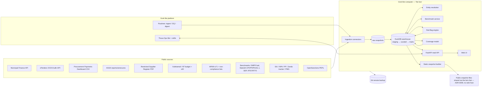

# Thusa — SA Public Expenditure Dashboard: Application Design

*Working name "Thusa" (placeholder; see open decision D-01). Version 0.1 (draft), 19 Oct 2026 SAST. Owner: L👀ty McFreely. Author: Grok Bot.*
*Inputs: [`../../sa_public_funds_landscape.md`](../../sa_public_funds_landscape.md) (landscape & gap analysis, 19 Oct 2026). ITIL artefacts: [`../../itil/`](../../itil/). Decisions: [`../adr/`](../adr/).*

> **Status legend:** **[verified]** confirmed from a cited source on 19 Oct 2026; **[assumption]** a design assumption to be confirmed; **[unverified]** could not be confirmed.

---

## 1. Vision and scope

**Vision.** The most comprehensive, honest dashboard of South African government spending for taxpayers. It ingests every public source, shows exactly what it does *not* know, flags exceptions with evidence, and puts benchmarks ("utilities on the glass") next to every number.

**Product principles**
1. **Sourced or silent.** Every figure links to its source document/row and retrieval timestamp. No estimates presented as facts.
2. **Known unknowns are first-class.** Coverage gaps are shown with the same prominence as data: missing years, non-submitting municipalities, unaudited entities, out-of-scope bodies (e.g. SOEs absent from the payments dashboard).
3. **Patterns, not verdicts.** A red flag is a question with evidence attached, not an accusation. Irregular expenditure is not theft (as AGSA itself distinguishes).
4. **Reproducible.** Any number can be rebuilt from raw snapshots by a pipeline run at a given git commit.
5. **Taxpayer-first UX.** Plain language, per-capita framing, mobile-friendly, free, no login to read.

**In scope (v1–v3):** national & provincial departments, municipalities/metros, public entities and SOEs (as data allows), procurement awards, procurement payments, IE/UIFW, audit outcomes, enforcement (SIU/AFU/PP/Zondo), restrictions/debarments, benchmarks (fuel, CPI, PPI, construction indices, medicine prices, transversal contract prices).

**Out of scope (for now):** personal data beyond what sources publish about legal persons and public office-bearers; private-sector spending; predicting "corruption probability" for named individuals; any non-public/leaked data.

**Platform framing — what "a Grok Bot app" means here.**
- **Grok Bot** is a platform of persistent Bots, each with a cloud computer (browser, filesystem, terminal), connectors/MCP, skills and routines. Routines run on schedules or events, even when the laptop is closed (https://docs.x.ai/grok-bot/overview ; https://docs.x.ai/grok-bot/skills-routines-and-automations) **[verified]**. All of a user's Bots share one computer, and files and credentials are visible to all of them (https://docs.x.ai/grok-bot/computer-and-apps) **[verified]**.
- Grok Bot's docs do not describe built-in public hosting of a web app from the Bot's computer **[unverified that none exists]**. Community templates publish via the **Vercel connector** (https://grokbotsdirectory.com/bots/website-builder-3Zzb23) or MCP deploy services such as xCloud (https://xcloud.host/agents/grok-bot/deploy-from-git/).
- **Grok Build** is a separate xAI product that publishes apps and dashboards, with connectors, secrets, custom domains and *Export to GitHub* (https://x.ai/news/grok-build-for-everyone) **[verified]**.
- Since 0.70 (11 Oct 2026), Grok Bot can show "in-chat apps" for connectors that ship one (https://x.ai/changelog/bot) **[verified]**. There is no documented way to ship your own in-chat app **[unverified]**.

**Distribution and access (ADR-0009, owner clarification 19 Oct 2026):** Thusa is a **Grok Bot app**. Users get it by
**importing the PublicFunds Bot template via its Grok Bot link** (`https://x.ai/bot/7Hr1hnJPXqOQbMmUZ7mTi`, a `grokbot://` bot-template share
link). It is **not a hosted website**.
- **The bot chat is the primary UI:** questions, flag explanations and review decisions.
- The local review web app (`pf serve` on 127.0.0.1) is a secondary tool that the bot opens in its own box browser
  for the user.
- Public web hosting is **not an MVP requirement** (D-03 and D-14 superseded).

**Design decision (ADR-0001, amended by ADR-0009):** build it as a **Grok Bot app**, made of four parts:

| Part | Role |
|---|---|
| (a) Data pipeline + local review web UI + `pf` CLI on the Bot's computer (the "box") | The engine and system of record |
| (b) Grok Bot **routines** | Scheduled ingestion, data-quality checks and alert digests |
| (c) The **PublicFunds Bot** (template; formerly "Thusa Ops") with skills | **Primary UI**: chat front end ("Ask Thusa", flag review), operator. Distributed via its Grok Bot template link |
| (d) A **public snapshot** artefact (`dist/public/`, confirmed flags only) | Shared by the bot as files (attachments/exports). ~~Published via Vercel or Grok Build (D-03)~~, superseded by ADR-0009 |

The box is the system of record. There is no public web host in the MVP.

---

## 2. Users and personas

| Persona | Goal | Key journeys | Must-haves |
|---|---|---|---|
| **Thandi — taxpayer/resident** (mobile, data-cost sensitive) | "What does my municipality spend, and is anything wrong?" | Search municipality → scorecard → per-capita spend → flags → "what we don't know" | Plain language, per-household framing, low-bandwidth pages, Afrikaans/isiZulu/isiXhosa labels (phase 3) |
| **Sipho — journalist** | Find leads fast and cite them | Search supplier → awards & payments across buyers → restriction status → evidence bundle export | Deep links, CSV export, provenance per row, alert on new data for a watchlist |
| **Naledi — civil-society analyst** (CW, OUTA, PSAM, IMALI YETHU) | Monitor sectors and advocate | Detector dashboards (e.g. fuel overpricing), coverage gaps, trend charts | Methodology pages, bulk API, reproducible notebooks |
| **Johan — auditor/oversight** (AGSA, SCOPA researcher, MPAC member) | Triage risk and track consequence | Entity risk profile → IE trend → MI status → recovery gaps | Filters by audit outcome, export to working papers, change history of figures |
| **Operator — L👀ty + Thusa Ops Bot** | Keep data fresh and correct | Routine runs, DQ failures, incidents, releases | Run logs, DQ dashboards, SLO burn, runbooks |

---

## 3. Functional requirements

IDs are referenced in tests and change records. Priority: **M** = must (MVP), **S** = should (phase 2), **C** = could (phase 3+).

### 3.1 Ingestion and provenance
| ID | Requirement | P |
|---|---|---|
| FR-ING-01 | Pull each registered source on its schedule; store an immutable raw snapshot with URL, retrieval time (UTC + SAST), HTTP status, SHA-256, size | M |
| FR-ING-02 | Detect "no change" (same hash) and record a heartbeat without reprocessing | M |
| FR-ING-03 | Fail loudly. A failed/blocked source never silently reuses old data as current; it is marked stale with age | M |
| FR-ING-04 | PDF extraction with page/table provenance (source page number retained) | M (RSR, DMPR), S (others) |
| FR-ING-05 | Source registry (`config/sources.yaml`) is the CMDB for data sources; adding a source = change record | M |

### 3.2 Data and analytics
| ID | Requirement | P |
|---|---|---|
| FR-DAT-01 | Canonical entities: government body (with sphere, province, type, demarcation code), supplier (with registration no. when published), commodity (UNSPSC/SCOA/MIIN), period (SA fiscal years: national 1 Apr–31 Mar, municipal 1 Jul–30 Jun) | M |
| FR-DAT-02 | Entity resolution for suppliers and government bodies with match confidence and reviewable merge decisions | M (rules), S (probabilistic) |
| FR-DAT-03 | Money stored as integer cents (ZAR) with nominal and real (CPI-deflated) views | M |
| FR-DAT-04 | Every fact row carries `source_snapshot_id` and `source_locator` (row/page/JSON path) | M |
| FR-DAT-05 | Coverage model (§6.6) computed for every entity × period × dataset | M |
| FR-DAT-06 | Benchmark service (§6.5) returns reference price + range + source for (commodity, region, date) | M (fuel, CPI), S (others) |
| FR-DAT-07 | Red-flag engine runs the 12 detectors (§6.7) with versioned rules, thresholds and explanations | M (4 detectors), S (8 more) |

### 3.3 User-facing
| ID | Requirement | P |
|---|---|---|
| FR-UI-01 | Entity pages (department, municipality, SOE, supplier) with spend, awards, payments, audit, IE, flags, coverage | M |
| FR-UI-02 | "What we don't know" panel on every page and a national coverage map | M |
| FR-UI-03 | Utilities on the glass: per-capita toggle, real/nominal toggle, benchmark overlay, peer comparison, fuel-price and CPI lookups | M (per-capita, real, fuel), S (rest) |
| FR-UI-04 | Flag cards show rule, evidence rows, benchmark, source links, caveats, and a "dispute/correction" link | M |
| FR-UI-05 | Search across entities, suppliers, tenders (full-text) | M |
| FR-UI-06 | CSV export of any table with provenance columns | M |
| FR-UI-07 | Public read-only API (REST + OpenAPI), rate-limited | S |
| FR-UI-08 | "Ask Thusa": conversational Q&A via the Thusa Ops Bot over the curated layer, always citing rows | S |
| FR-UI-09 | Watchlists and alerts (email digest via the Bot's own inbox, after user approval) | S |
| FR-UI-10 | Corrections workflow: public submissions → triage → correction log | S |
| FR-UI-11 | Multilingual labels (af, zu, xh, st) | C |

---

## 4. Non-functional requirements (summary; SLOs in `itil/sla-slo.md`)

| Area | Target |
|---|---|
| Freshness | Each source ingested within its SLO window after publication (e.g. municipal API ≤ 7 days, OCDS ≤ 2 days, fuel ≤ 3 days) |
| Availability | Public snapshot 99.5% monthly; box API 99.0% (single box, no HA, which is explicit) |
| Performance | Entity page p95 < 1.5 s on box; public static pages < 2.5 s LCP on throttled 4G mid-range Android |
| Correctness | 0 known-wrong published figures older than 48 h after detection (correction SLO) |
| Reproducibility | Any published number re-derivable from raw snapshot + commit in one command |
| Accessibility | WCAG 2.2 AA for public UI |
| Privacy | POPIA-aligned; no special personal information; see §10 |

---

## 5. Architecture

### 5.1 Context

### 5.2 Components

| Component | Responsibility | Implementation |
|---|---|---|
| **Source registry** | Declarative list of sources: URL, method, schedule, parser, licence, SLO, owner | `config/sources.yaml` (doubles as data-source CI register) |
| **Ingestion connectors** | One Python module per source family: `http_json`, `ocds_bulk`, `muni_cube`, `pdf_table`, `xls_zip`, `html_list`, `csv_manual_drop` | Python 3.13, `httpx` (retries with jitter, conditional GET), `pdfplumber`/`camelot`, `openpyxl` |
| **Raw store** | Immutable files under `data/raw/<source>/<yyyy>/<mm>/<dd>/<sha256>.<ext>` + manifest row | Local disk (120 GB free); offsite copy (D-05) |
| **Warehouse** | Layered: `staging` (typed, 1:1 with source), `curated` (conformed entities/facts), `marts` (UI/API-shaped) | **DuckDB** single file + Parquet exports; transforms in **dbt-duckdb** (ADR-0002) |
| **Entity resolution** | Suppliers: deterministic on registration no. → normalised name + province → probabilistic (Splink) with human review queue. Government bodies: curated crosswalk (MDB demarcation codes, NT vote numbers, AGSA auditee names, OCDS buyer names, PPD dept names) | `splink` on DuckDB backend; review UI page |
| **Benchmark service** | Reference prices and indices keyed by commodity × region × date | Tables `benchmark_series`, `benchmark_observation`; Python parsers for DMPR ZIP/PDF, Stats SA ZIP |
| **Red-flag engine** | Detector plugins with versioned YAML config; outputs `flag` rows with evidence and explanation; also runs OCP **Cardinal** on OCDS | Python + SQL; Cardinal CLI (https://cardinal.readthedocs.io/en/latest/cli/indicators/) |
| **Coverage model** | Expected vs observed facts per entity × period × dataset; reasons | SQL marts + rules from s71 non-compliance lists, AGSA outstanding audits, scope statements |
| **API** | Read-only REST + OpenAPI; versioned `/v1`; cursor pagination; ETags | **FastAPI** + DuckDB read-only connection |
| **Web UI** | Server-rendered pages, progressive enhancement | Jinja2 + HTMX + Apache ECharts; Tailwind (prebuilt CSS) |
| **Static snapshot builder** | Pre-renders public pages + JSON/CSV/Parquet downloads per release | Python crawler of the box UI → `dist/` → deploy |
| **Thusa Ops Bot** | Runs routines, triages DQ failures, answers questions via API, drafts digests (send needs approval) | Grok Bot Bot with skills: `thusa-ingest`, `thusa-dq-triage`, `thusa-release`, `thusa-ask` |
| **Observability** | Structured logs, run ledger, metrics, DQ results, SLO burn | JSON logs + DuckDB `ops` schema + Prometheus-format `/metrics` (optional); weekly SLO report |

### 5.3 Data layers

| Layer | Contents | Rules |
|---|---|---|
| `raw` (files) | Exact bytes as retrieved | Never modified; deleted only per retention policy (keep all ≥ 3 years, D-06) |
| `staging` | Parsed, typed, renamed columns; one model per source table | No business logic; rows keep `source_snapshot_id`, `source_locator` |
| `curated` | Conformed dimensions (`gov_body`, `supplier`, `commodity`, `period`, `geography`) and facts (`budget_line`, `actual_line`, `award`, `contract`, `payment_agg`, `uifw_line`, `audit_outcome`, `restriction`, `enforcement_event`) | Tested (unique keys, FK integrity, accepted values, reconciliations) |
| `marts` | Entity scorecards, coverage matrix, flag views, benchmark joins, per-capita tables | Built for UI/API; documented in dbt docs |
| `ops` | Ingestion runs, DQ results, incidents link, release manifest | Feeds SLO reporting |

### 5.4 Ingestion connectors (MVP set marked ★)

| Source | Connector | Method & notes | Schedule (routine) |
|---|---|---|---|
| ★ Municipal Finance Data API (21 cubes) | `muni_cube` | JSON `/api/cubes/<cube>/facts` paging + bulk CSV; detect quarter loads | Weekly Mon 02:00 SAST |
| ★ eTenders OCDS | `ocds_bulk` | Treasury monthly bulk files (preferred) + OCP registry mirror (fallback) + API delta when healthy; API returned 500/timeouts on 19 Oct 2026, so the connector must tolerate it | Daily 03:00 |
| ★ Procurement Payments Dashboard | `csv_manual_drop` then `pbi_export` | MVP: operator downloads `Procurement_Spend_Transaction_List.csv` per quarterly release into `inbox/`; Bot validates. Later: automated export via the box browser **only if** the site's terms allow it (D-07) | Quarterly + check weekly |
| ★ Restricted Supplier Register | `pdf_table` | OCPO PDF; diff entries; keep history of additions/removals | Weekly |
| ★ AGSA PFMA/MFMA annexures & outcomes | `pdf_table` / `xls` | Annual; MFMA microsite pages | Monthly check |
| ★ Vulekamali / ENE / EPRE / s32 monthly | `http_json` / `xls_zip` | Datastore was failing on 19 Oct 2026; fall back to treasury.gov.za Excel | Monthly (s32: day 3 of month) |
| ★ DMPR fuel prices | `pdf_table` (ZIP) | Monthly adjustment docs; parse "History of Fuel Prices" + zone breakdown | Monthly, first Wed + 2 days |
| ★ Stats SA CPI/PPI/P0151.1 | `xls_zip` | WAF blocks scripted access, so manual drop or browser download by the Bot (D-07) | Monthly |
| ★ MFMA s71 non-compliance lists | `pdf_table` | Quarterly | Quarterly |
| SIU proclamations / annual reports | `html_list` + `pdf_table` | Phase 2 | Monthly |
| NPA AFU, PP reports, Zondo trackers | `pdf_table` / `html_list` | Phase 2–3 | Monthly |
| OpenSanctions SA PEPs | `http_json` | CC BY-NC, so licence check needed for any commercial use | Weekly |
| PMG API (SCOPA, replies) | `http_json` | Phase 3 text mining | Weekly |
| NDoH SEP, RT57/RT70 price lists | `xls` / `pdf_table` | Phase 2 benchmarks | Monthly |
| Metro award registers (CoCT, Joburg), Eskom/Transnet | `html_list`/`pdf_table` | Phase 3 | Monthly |

---

## 6. Data model (core entities)

DDL draft: [`../../sql/core_schema.sql`](../../sql/core_schema.sql). Summary:

### 6.1 Provenance
- `source` (source_id, name, owner_org, url, licence, cadence, sla_freshness_days)
- `source_snapshot` (snapshot_id, source_id, url, retrieved_at_utc, http_status, sha256, bytes, parser_version, status[ok|unchanged|failed|blocked])

### 6.2 Dimensions
- `gov_body` (gov_body_id, name, sphere[national|provincial|local|soe|public_entity|constitutional|education|health], province, body_type[department|metro|district|local|soe|schedule3a|seta|tvet|university|legislature], demarcation_code, nt_vote_no, pfma_schedule, parent_gov_body_id, valid_from, valid_to)
- `gov_body_alias` (alias, source_id, gov_body_id, match_method, confidence, reviewed_by)
- `supplier` (supplier_id, canonical_name, cipc_reg_no, csd_no (rarely public), supplier_type, province, first_seen, is_person boolean). Persons are handled per §10.
- `supplier_alias` (raw_name, raw_reg_no, source_id, supplier_id, match_method, confidence, review_status)
- `commodity` (commodity_id, scheme[UNSPSC|SCOA|MIIN|COICOP|internal], code, label, parent_id) + `commodity_map` (cross-scheme)
- `period` (period_id, fiscal_scheme[national|municipal], fy, quarter, month, start_date, end_date)
- `geography` (geo_id, level, code, name, population, households, source_year)

### 6.3 Facts
| Table | Grain | Key measures |
|---|---|---|
| `budget_line` | body × period × programme/item × budget phase | amount_cents |
| `actual_line` | body × period × item (muni cubes, s32, PPD aggregates) | amount_cents |
| `tender` / `award` / `contract` | OCDS ocid × award/contract id | value_cents, currency, method, dates, supplier_id |
| `payment_agg` | body × supplier × commodity × fiscal year (PPD grain) | amount_cents, txn_count, quantity, avg_unit_price_cents (LOGIS) |
| `uifw_line` | body × period × type[unauthorised / irregular / fruitless] × measure[incurred / condoned / written_off / recovered / under_assessment] | amount_cents |
| `audit_outcome` | body × fiscal year | opinion, findings flags, MI count, AFS submitted flag |
| `restriction` | supplier/person × authority × period | reason, from, to |
| `enforcement_event` | case × event | body, type[proclamation|set_aside|recovery|referral|conviction], amount_cents |
| `benchmark_observation` | series × region × date | value, unit, source |

### 6.4 Analytical outputs
- `flag` (flag_id, detector_id, detector_version, subject_type, subject_id, period_id, severity[info|low|med|high], score, explanation_md, evidence_json, benchmark_ref, status[open|reviewed|dismissed|published], created_run_id)
- `coverage_cell` (entity_id, dataset_id, period_id, expected boolean, observed boolean, completeness_pct, state[complete|partial|missing|not_applicable|out_of_scope|late|unaudited], reason_code, reason_source_snapshot_id)

### 6.5 Price-benchmark layer ("utilities on the glass")
| Benchmark | Source | Unit/grain | Use |
|---|---|---|---|
| Diesel/petrol retail and wholesale guideline by zone/month | DMPR fuel docs (https://www.dmpr.gov.za/Branches/Petroleum-Resources/Fuel-Prices) | c/litre, zone, month | Detector D1 |
| Transversal contract prices | NT RT70 fuel, RT57 vehicles (https://www.treasury.gov.za/divisions/ocpo/ostb/contracts/Amendment%2011%20-%20Revised%20Implementation%20Guide.pdf) | item price | D1, D2 ceilings |
| CPI headline + 8-digit + average prices | Stats SA (https://www.statssa.gov.za/?page_id=1847) | index / R per unit | Real terms; D2 |
| PPI, construction material indices (P0151.1) | Stats SA | index | Escalation checks |
| Medicine SEP | NDoH (https://www.health.gov.za/nhi-pee/) | R per pack | D2 (health) |
| Peer-group medians | Internal (PPD LOGIS, OCDS) | R per unit/commodity | D2, D4 |
| Population/households | Stats SA Census 2022 **[source table to confirm]** | people | Per-capita toggles |

Each benchmark lookup returns `{value, low, high, method, source_url, retrieved_at}` so the UI can show "R26.26/l paid vs R21.33/l reference (+23%)" with a link.

### 6.6 "Known unknowns" coverage model
For each **entity × dataset × period**, compute the `expected` and `observed` columns and assign a **state**:

| State | Rule (examples) | Display |
|---|---|---|
| `complete` | Observed all expected facts | normal |
| `partial` | e.g. award without value (29% of OCDS awards in the 19 Oct sample) | amber, % shown |
| `missing` | Expected but absent (municipality with no s71 return) | red hatching |
| `late` | Source says submitted late / listed in s71 non-compliance PDF | red + reason link |
| `unaudited` | AGSA outstanding audit / AFS not submitted (e.g. Maluti-A-Phofung 2024-25) | red badge |
| `out_of_scope` | Dataset structurally excludes it (e.g. PPD excludes SOEs, municipalities, Defence, SAPS, SARS, SSA, legislatures) | grey + scope note |
| `not_applicable` | Entity didn't exist (demarcation changes) | blank |

The model rolls up to entity coverage scores, a national coverage map and "R value we can't see" estimates (e.g. budget of bodies with `out_of_scope` payment coverage). Each estimate is labelled as an estimate with its formula.

### 6.7 Red-flag engine — the 12 detectors

| ID | Detector | MVP? | Data | Rule (v1) | Caveat shown |
|---|---|---|---|---|---|
| D1 | Fuel unit-price vs benchmark | ★ | PPD LOGIS avg unit price (fuel MIIN groups), DMPR, RT70 | price > benchmark × 1.20 for zone/month (year avg if monthly unavailable) | LOGIS gives annual averages per MIIN group; delivery costs may apply |
| D2 | Generic unit-price outlier | phase 2 | PPD LOGIS, SEP, RT57, CPI avg prices | robust z (median/MAD) > 3.5 within commodity × year | Specs differ; group-level averages |
| D3 | Barred-and-awarded / barred-and-paid | ★ | RSR + OCDS + PPD | award/payment date within restriction window; match confidence ≥ 0.9 | Restriction by one organ may not bind another; name-match risk |
| D4 | Supplier concentration | ★ | PPD, OCDS | buyer × commodity HHI > 2,500 or top supplier share > 50% over 3 yrs | Some markets are legitimately concentrated |
| D5 | Non-competitive share | ★ | OCDS method; LOGIS contract type "Non-Contract" | share > peer P90 | Under-reporting of limited/direct methods |
| D6 | Threshold splitting | phase 3 | order-level data (not yet public) | clusters just below thresholds | Blocked by aggregation; shown as a "can't test" coverage item |
| D7 | Budget–payment–audit triangulation | phase 2 | VK, PPD, AGSA | high payments growth + IE completeness qualification + MIs | Composite; explain each component |
| D8 | Municipal distress & coverage | ★ (as coverage + score) | MM cubes, s71 lists, AGSA | rules on cash coverage, creditor age > 90d, UIFW trend, non-submission | Data unverified by NT |
| D9 | Related-party (PEP/official) | phase 3 | OpenSanctions, PMG RMI, MM officials, supplier directors (blocked) | exact/near match on person names + corroborating attribute | High false-positive risk; human review mandatory before publish |
| D10 | Award vs contractor capacity | phase 2 | OCDS + CIDB lookup + CIPC reg-year | value > CIDB grade limit; company < 12 months old with award > R10m | Lookup coverage |
| D11 | Contract expansion / evergreen | phase 3 | deviation registers (restricted), OCDS amendments (0 today) | variation > 15/20% | Data access blocked |
| D12 | Consequence gap | phase 2 | AGSA, MM uifwexp, SIU | IE incurred vs recovered/written-off ratio; MIs unresolved > 1 yr | Different periods/institutions |

**Engine rules:** detectors are versioned (`detector_id@semver`). Thresholds live in [`../../config/detectors.yaml`](../../config/detectors.yaml). Every flag stores the evidence rows and benchmark snapshot. **High-severity flags naming a supplier or person need human review (status `reviewed`) before they appear publicly** (an ITIL change-type rule; see §11). Detector precision is tracked against a labelled set (§12).

---

## 7. API (v1, read-only)

| Endpoint | Purpose |
|---|---|
| `GET /v1/bodies?sphere=&province=&q=` | List/search government bodies |
| `GET /v1/bodies/{id}` | Profile + latest scorecard + coverage summary |
| `GET /v1/bodies/{id}/spend?fy=&view=real or nominal&per=capita or total` | Budget vs actual |
| `GET /v1/bodies/{id}/awards` · `/payments` · `/uifw` · `/audit` · `/flags` · `/coverage` | Facets |
| `GET /v1/suppliers/{id}` | Supplier profile, aliases, awards, payments, restrictions |
| `GET /v1/flags?detector=&severity=&status=published` | Published flags |
| `GET /v1/coverage?dataset=&fy=` | Coverage matrix |
| `GET /v1/benchmarks/{series}?region=&date=` | Benchmark lookup (fuel, CPI…) |
| `GET /v1/sources` · `/v1/sources/{id}/snapshots` | Provenance and freshness |
| `GET /v1/meta/release` | Current data release, commit, build time |

Conventions: OpenAPI 3.1, cursor pagination, ETag/Cache-Control, CSV via `Accept: text/csv`, rate limit 60 req/min/IP on public host, provenance columns on every row, explicit `null` (never 0) for missing.

---

## 8. Dashboard UI and "utilities on the glass"

**Pages:** Home (national picture + coverage map) · Municipality/department/SOE pages · Supplier page · Flags explorer · Coverage explorer · Benchmarks (fuel price history, CPI calculator) · Methodology · Sources & freshness · Corrections log.

**On-glass utilities (always one click away):**
1. **Per-capita / per-household toggle** (geography denominators)
2. **Real vs nominal** (CPI-deflated to a chosen base year)
3. **Benchmark overlay** on any unit-price chart (fuel, medicines, vehicles)
4. **Peer comparison** (same body type and size band, e.g. secondary cities)
5. **Fuel price lookup** ("what was diesel in Zone X in Month Y?")
6. **CPI calculator** ("R1m in 2018 = R? today")
7. **Supplier lookup** (aliases, restriction status, buyers, years active)
8. **"What don't we know?" drawer** listing coverage cells for the current view
9. **Source pin** on every number (hover = source, retrieval time, snapshot hash; click = original)
10. **Export** (CSV with provenance) and **share link** to exact state

**UX rules:** empty, loading and error states on every view. Plain-language glossary. No red without a reason. Mobile-first tables (cards on small screens). Low-bandwidth mode.

---

## 9. Alerting

| Alert | Audience | Channel | Approval |
|---|---|---|---|
| Ingestion failure / stale source beyond SLO | Operator | Grok Bot chat (routine output) | none (internal) |
| DQ test failure blocking release | Operator | Grok Bot chat | none |
| New high-severity flag awaiting review | Operator / reviewer | Grok Bot chat | review required |
| Watchlist digest (supplier/body) | Public subscribers (phase 2) | Email from the Bot's own inbox | **First send of each new digest template is approved by the user, then a standard change (ITIL)** |
| SLO burn > 50% of monthly budget | Operator | Grok Bot chat | none |

Routines follow Grok Bot guidance: narrow triggers, explicit failure reporting, never use old data as current (https://docs.x.ai/grok-bot/skills-routines-and-automations).

---

## 10. Security, privacy and legal

**POPIA (Act 4 of 2013).** Data about juristic persons (companies) is personal information under POPIA's definitions **[legal review recommended]**. Natural persons appear in sources: sole proprietors, restricted individuals with ID numbers in the RSR PDF, officials, MPs. Controls:
- **Never publish SA ID numbers.** Hash them (HMAC with a secret pepper) for matching; drop them from public marts.
- Publish natural-person names only where the source publishes them in an official-capacity or debarment context, and only alongside that context.
- Lawful basis: processing of publicly available records for public-interest accountability and journalism. Document a **POPIA impact assessment** and appoint an Information Officer (the user, by default) **[assumption]**.
- Data-subject requests: a corrections/objection channel with a 30-day response target.
- Retention: raw snapshots ≥ 3 years for reproducibility (D-06); delete superseded personal identifiers from marts on each rebuild.

**PAIA (Act 2 of 2000).** Track requests in a `paia_request` register (body, records requested, date, deemed-refusal date at 30 days, outcome). Ingest PAIA-obtained records only where release terms allow publication.

**Defamation and fairness.** Flags are framed as questions with evidence. High-severity named flags require human review. Right of reply: entities can respond, and responses are shown on the flag. Methodology is public.

**Licensing.** Respect source licences (eTenders PDDL vs CC BY 4.0 inconsistency, so attribute anyway; OpenSanctions CC BY-NC, so non-commercial only unless licensed). Each source licence is recorded in `config/sources.yaml`.

**Security (informed by Posts 1 and 3, §13):**
- **Secrets:** no secrets in the repo (`.gitignore` covers `.env`). Store them in Grok Bot secrets. Rotate any key that ever appears in chat or config. Remember that box credentials are shared by all of the user's Bots.
- **Least privilege:** there is no public host in the MVP (ADR-0009). The review web app binds to localhost only, and its warehouse connection is read-only.
- **Web hygiene:** security headers (CSP, HSTS, X-Content-Type-Options, frame-ancestors none), no CORS wildcard on write endpoints (there are none), server-side input validation, parameterised SQL only (DuckDB prepared statements), request size limits, rate limits.
- **Supply chain:** lockfile (`uv.lock`), `pip-audit`/OSV scan in CI, secret scanning (gitleaks) pre-commit, verify every package an AI agent adds actually exists and is the intended one.
- **AI-specific:** "Ask Thusa" treats source text as untrusted (prompt-injection-safe tool design). The Bot answers only from API results and cites rows. No write tools are exposed to the conversational path.
- **Backups:** nightly DuckDB backup + raw snapshot sync. **A tested restore every month** (a backup you've never restored is a hope).

---

## 11. Delivery: MVP and phased roadmap

**MVP (“Prototype 0”, ~4–6 weeks of focused work) — goal: one honest page per municipality and department, plus four detectors.**
1. Sources: Municipal Finance API, OCDS (bulk), PPD transaction CSV (manual drop), RSR PDF, AGSA 2024-25 outcomes/IE, s71 non-compliance lists, DMPR fuel, CPI.
2. Curated: gov_body crosswalk (292 municipalities + ~193 departments + top SOEs), supplier ER (rules only), periods, geography (population).
3. Detectors: **D1 fuel**, **D3 barred**, **D4 concentration**, **D8 municipal distress & coverage**; plus D5 as an info-level indicator.
4. UI: Home, Municipality page, Department page, Supplier page, Flags list, Coverage explorer, Fuel benchmark tool, Sources & freshness, Methodology.
5. Ops: three routines (daily ingest, weekly DQ report, monthly release), run ledger, SLO report, backups + restore test, ITIL artefacts live.
6. Distribution: the PublicFunds Bot Grok Bot template (`https://x.ai/bot/7Hr1hnJPXqOQbMmUZ7mTi`). The public snapshot is a confirmed-only file artefact shared by the bot; any web hosting is a later, separately approved change (ADR-0009).

**Phase 2 (months 2–4):** D2, D7, D10, D12. NDoH SEP and RT57/RT70 benchmarks. Probabilistic ER with review UI. Public read API. Watchlist digests. SIU/AFU/PP ingestion. Corrections workflow. "Ask Thusa" in the Bot.

**Phase 3 (months 4–9):** D9 (with legal review), D6/D11 if data becomes available. Metro and SOE award registers. PMG text mining. Multilingual. Partnerships (TenderWatch, Corruption Watch, OUTA, OpenUp, OCP). Advocacy dataset for the replacement procurement law (s31-style disclosure).

**Exit criteria for MVP:** all M requirements pass acceptance tests; SLOs measured for 4 consecutive weeks; restore test passed; 0 open high-severity incidents; methodology reviewed by one external domain expert **[assumption]**.

---

## 12. Testing strategy

| Layer | What | Tooling |
|---|---|---|
| Unit | Parsers (fixture files from real snapshots, incl. ugly PDFs), money/period utilities (integer cents, fiscal-year boundaries, SAST/UTC), detector logic | `pytest`, `hypothesis` for property tests (e.g. per-capita never divides by null) |
| Data tests | Unique keys, not-null, FK integrity, accepted values; **reconciliations**: e.g. municipal UIFW totals vs AGSA MFMA report totals (tolerance documented); OCDS award counts vs portal headline; PPD totals vs Vulindlela-published aggregates where available | dbt tests + custom SQL tests |
| Contract | Each source's expected schema; alert on drift (column added/removed, type change) | Schema snapshots per source |
| Detector evaluation | Labelled set of known cases (e.g. NW Agriculture diesel R26.26 vs R21.33/l, 2023; restricted-supplier awards) and known-clean cases; track precision/recall per detector version. **Every confirmed false positive or missed case becomes a permanent test case** (from Post 2) | `pytest` + `eval/` set |
| API | OpenAPI conformance, pagination on page 400, CSV export, ETags | `schemathesis` |
| UI / E2E | Key journeys (search municipality → flag → source link); empty/error states; low-end Android emulation on slow 4G; Lighthouse ×3 median before/after (from Post 4) | Playwright, Lighthouse CI |
| Security | Headers, dependency scan, secret scan, basic DAST on preview | `pip-audit`, `gitleaks`, OWASP ZAP baseline |
| Restore | Monthly restore of DuckDB + raw snapshots into a scratch dir and rebuild a mart; compare hashes | runbook RB-04 |

---

## 13. Engineering practices (beyond vibe coding)

These are drawn from the three recent @DiscoveringAI reposts (verified via X API, 19 Oct 2026) plus a fourth related repost. Each practice is tagged with its source post.

| Post | Author | Date (SAST) | Link |
|---|---|---|---|
| **P1** | @ghumare64 | 17 Oct 2026 07:46 | https://x.com/ghumare64/status/2111332908657148356 (quoted by @DiscoveringAI at https://x.com/DiscoveringAI/status/2111775575069086138) |
| **P2** | @ClaudeDevs | 16 Oct 2026 20:54 | https://x.com/ClaudeDevs/status/2111168901723906176, linking https://claude.dev/blog/solving-code-review-at-anthropic/ (quoted at https://x.com/DiscoveringAI/status/2111317158814777408) |
| **P3** | @mardehaym | 15 Oct 2026 14:12 | https://x.com/mardehaym/status/2110705357492203564 (quoted at https://x.com/DiscoveringAI/status/2110961073717215702) |
| P4 (related) | @Voxyz_ai | 13 Oct 2026 21:00 | https://x.com/Voxyz_ai/status/2110083153930920113 (quoted at https://x.com/DiscoveringAI/status/2111323433279635484) |

| # | Practice adopted in Thusa | From |
|---|---|---|
| E1 | **Designed schema first** (§6, `sql/core_schema.sql`), not improvised table by table; migrations forward *and* rollback | P3, P1 (migrations, down migrations) |
| E2 | **Money as integer cents**, timezones stored explicitly (UTC + SAST display), apostrophes/accents/emoji-safe text | P3 |
| E3 | **Server-side validation**, parameterised SQL, OWASP list (SQLi, XSS, CSRF, SSRF, path traversal), security headers, CORS not "allow all" | P1, P3 |
| E4 | **Secrets out of code, repo and AI chat history**; `.env` in `.gitignore`; secret scanning; key rotation | P1, P3 |
| E5 | **Verify every package the AI adds exists and is the intended one**; lockfiles; dependency scanning; reproducible builds | P3, P1 |
| E6 | **Backups + tested restores + point-in-time recovery** (raw snapshots make it possible) | P1, P3 |
| E7 | **Indexes / EXPLAIN / avoid N+1 / cursor pagination** that works on page 400 | P1, P3, P4 |
| E8 | **Give the agent a way to verify its work**: tests, builds, screenshots; show output instead of claiming done | P2 |
| E9 | **`AGENTS.md`** (project context: stack, conventions, goals, non-goals; short) and **`REVIEW.md`** (what failure looks like here: "it lies" = an unsourced or wrong number; cap nits; file+line evidence) | P2 |
| E10 | **AI review on every PR + separate security review that can block**; every finding fixed or resolved with a reason | P2 |
| E11 | **Risk tiers set by the change, not the author**: low (docs, copy) = automated checks only; medium = 1 human; high (detector thresholds, publication pipeline, secrets, CI) = 2 approvals or owner + explicit sign-off. Maps to ITIL standard / normal / high-risk normal changes | P2 |
| E12 | **PR template with Testing, Risk, How to revert**; approval covers a specific commit; bot approval never replaces a required human | P2 |
| E13 | **Cap review rounds at 3**, then re-review diff only; flag the class of bug, not one line | P2 |
| E14 | **Incidents and reverts become an eval set**; rescore the reviewer and detectors on every change of prompts/models | P2 |
| E15 | **Feature flags, staged release** (private preview → public), **one-step rollback** (previous static snapshot) | P2, P3, P1 |
| E16 | **Structured logs, error tracking, uptime checks from outside, alerts tuned to stop false pages, runbooks, postmortems that change something** | P3, P1 |
| E17 | **SLOs and error budgets**, RTO/RPO documented | P1 |
| E18 | **ADRs: architecture decisions written down with reasons**; README gets a newcomer running in < 1 hour; bus factor > 1 | P3 |
| E19 | **Prompt-injection protection** wherever source text reaches the model; human approval for anything irreversible; evals for model updates; fallback when the model provider is down | P3 |
| E20 | **Accounts, domain and repo in the project's/owner's name**, not a prototype builder's | P3 |
| E21 | **Performance pass before public launch**: four parallel checks (assets, frontend, database, network), Lighthouse ×3 median on mobile before/after, low-end Android on slow 4G | P4 |
| E22 | **Don't let agents loop forever**: cost/usage caps on routines; review convergence | P2, P3 (cost alerts) |

Practices from P1/P3 that **don't apply yet** (recorded so they're not forgotten): SSO/SAML/SCIM, payments/billing, multi-tenant isolation, HIPAA/PCI, multi-region. Revisit if the product gains logins or paid tiers.

---

## 14. Observability

| Signal | Implementation | Used for |
|---|---|---|
| Run ledger (`ops.ingest_run`) | Every connector run: source, start/end, status, rows, snapshot ids, error class | Freshness SLO, incident detection |
| DQ results (`ops.dq_result`) | dbt test outcomes per build | Release gate |
| Structured JSON logs | `structlog`, correlation id = run_id/request_id, no secrets/IDs | Debugging |
| Metrics | Freshness age per source, rows ingested, flags by detector, API p95, error rate | SLO dashboard (internal page) |
| External uptime check | Simple HTTP check of public snapshot from outside the box **[tool to choose: D-08]** | Availability SLO |
| Weekly SLO report | Routine generates and posts to Grok Bot chat | Service level management |

---

## 15. ITIL 4 alignment (summary; details in `itil/itil-practice-map.md`)

**Value chain mapping**

| Activity | Mapping |
|---|---|
| **Plan** | Roadmap §11, risk register |
| **Improve** | CSI register |
| **Engage** | Personas, corrections channel, partner engagement |
| **Design & transition** | This document, ADRs, change and release practice |
| **Obtain/build** | Pipeline and UI code |
| **Deliver & support** | Routines, incidents, SLOs |

**Practices instantiated in the repo:** service catalogue entry, SLA/SLO draft, change enablement (templates and change types), release and deployment management (checklist), incident and problem management (templates), service configuration management (CI register + `config/sources.yaml`), information security management (§10), knowledge management (`itil/knowledge/` runbooks + methodology), continual improvement (CSI register), monitoring and event management (§14), and the decision log (ADRs).

---

## 16. Open decisions (need the user)

| ID | Decision | Options | Recommendation |
|---|---|---|---|
| D-01 | Product name | "Thusa" (placeholder) / other | User's call |
| ~~D-02~~ | ~~Git remote~~ | **Resolved:** GitHub `farwaters/publicfunds-sa` (CHG-2026-001). Made **public** by the owner on 19 Oct 2026 ~11:21 SAST, after a clean history secret scan (CHG-2026-004) | — |
| ~~D-03~~ | ~~Public hosting of snapshots~~ | **Superseded by Grok Bot template distribution (ADR-0009, 19 Oct 2026)** | No public web hosting in the MVP |
| D-04 | Public vs private launch timing | Private beta with partners first / public from MVP | Private beta with 2–3 partners |
| D-05 | Offsite backup target | Git LFS / Google Drive (connector) / S3-compatible | Google Drive or S3 for raw snapshots; git for code/docs only |
| D-06 | Raw snapshot retention | 3 years / indefinite | Indefinite for non-personal; 3 years for files with ID numbers |
| D-07 | Automated downloads from WAF/Power-BI sources (Stats SA, PPD) | Manual drop / browser automation by the Bot / ask publishers for feeds | Manual drop for MVP + request feeds from OCPO and Stats SA |
| D-08 | External uptime monitor | Free SaaS / none in MVP | Free SaaS once public |
| D-09 | Legal review (POPIA, defamation) before publishing named flags | Pro-bono (e.g. via civil-society partners) / paid | Required before any named high-severity flag goes public |
| D-10 | Partnerships | TenderWatch, Corruption Watch, OUTA, OpenUp, OCP | Approach TenderWatch and OCP first (method overlap) |
| D-11 | Thusa Ops Bot + daily routine (CI-003/004) | Create now / after v0.1.0 merge | After PR #1 merges |
| D-12 | **PARKED by the owner (19 Oct 2026): no second human reviewer yet. Don't raise it again; the owner will reopen it.** Who the second (and further) independent reviewers are; is a legal reviewer needed for D3? (CHG-2026-003, CSI-016) | Partner org staff / volunteer journalists / paid | Parked. Until then, named-supplier flags stop at `awaiting second review` and aren't published |
| D-13 | Public treatment of unconfirmed, non-named flags (`config/publication.yaml`) | `exclude` / `label` as "unreviewed lead" | `exclude` until the first reviewed release, then reconsider |
| ~~D-14~~ | ~~Remote access to the review app~~ | **Superseded by Grok Bot template distribution (ADR-0009, 19 Oct 2026)**: the bot chat is the primary UI; the bot opens the localhost app in its own box browser | Localhost only |
| D-15 | Fill in and verify the PublicFunds Bot template link `https://x.ai/bot/7Hr1hnJPXqOQbMmUZ7mTi` and its contents (docs/bot/template.md, docs/bot/skills/). The repo is public, so importers need no GitHub access (CHG-2026-004) | Owner creates the share link | Before the first external import (CHG-2026-005) |
